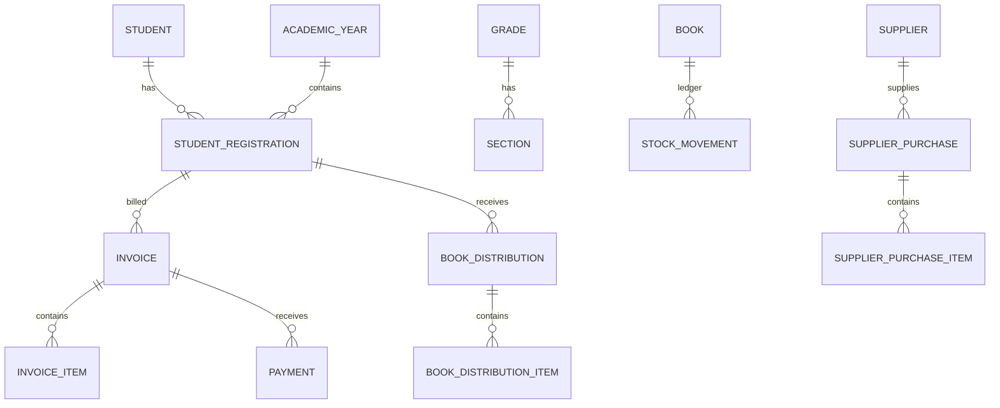

# School Book Manager

Laravel 12 application for school book inventory, distribution, student invoices and payment collection. It uses a server-rendered Blade interface, MySQL database `SBM`, Vite, first-party authentication, and a lightweight first-party RBAC layer.

## Delivery summary

- Secure login/logout/password-reset flow with throttling, session regeneration, active-account enforcement, and last-login IP/time recording.
- Granular server-side roles: Super Administrator, School Administrator, Inventory Manager, Accountant, and Auditor.
- Academic years, levels, grades, sections, students, registrations, teachers, responsible persons, books, class book packages, suppliers, and purchase receipts.
- Transactional supplier receiving, stock adjustments, student distribution, invoices, partial payments, payment reversals, deferred approvals, and returns.
- Immutable inventory ledger and audit log. Financial/inventory events are reversed or cancelled, never normally deleted.
- Printable invoice and receipt, CSV reports, recycle bin, responsive light UI, and protected private deferred-approval files.

## Assumptions

`SBM` is the MySQL database and the local XAMPP MySQL account is `root` with no password. Change these values in `.env` if your installation differs. No monetary operation uses PHP floating point arithmetic; workflow calculations use integer cents and persist as `DECIMAL(14,2)`.

## Main entities

`academic_years`, `school_levels`, `grades`, `sections`, `students`, `student_registrations`, `responsible_persons`, `teachers`, `books`, `class_book_lists`, `suppliers`, `supplier_purchases`, `invoices`, `payments`, `deferred_payment_approvals`, `book_distributions`, `book_returns`, `stock_movements`, `stock_adjustments`, `audit_logs`, and RBAC tables.



## Install locally

1. Start MySQL in XAMPP, then create the database:

   ```sql
   CREATE DATABASE SBM CHARACTER SET utf8mb4 COLLATE utf8mb4_unicode_ci;
   ```

2. Install and configure:

   ```powershell
   composer install
   Copy-Item .env.example .env
   php artisan key:generate
   npm.cmd install
   php artisan migrate --seed
   npm.cmd run build
   php artisan serve
   ```

3. Sign in with `admin@school.test` and the development seed password `ChangeMe123!`, then change it immediately. Set `SBM_ADMIN_EMAIL` and `SBM_ADMIN_PASSWORD` before production seeding instead of using the demo values.

## Critical workflows

1. Receive a supplier purchase: creates a supplier-receipt stock ledger record under a database lock.
2. Distribute books: locks each book, verifies available stock, creates invoice/distribution rows, moves stock, and optionally records payment in one transaction.
3. Record payment: locks invoice, validates balance, creates immutable payment, and recalculates derived invoice balances.
4. Return books: validates original distribution quantities and restores stock only when the returned condition is `new_resellable`.

## Security model

Routes are protected using authentication plus the `permission` middleware; the UI never substitutes for authorization. Sensitive invoice operations also use policies. Private approval attachments use Laravel local storage and an authorized download endpoint. Security headers, CSRF, validated uploads, output escaping, idempotency keys, rate limiting, soft deletes for master records, restrictive financial foreign keys, and audit logs are included.

## Tests and checks

```powershell
php artisan test
php artisan view:cache
php artisan config:cache
php artisan route:cache
```

The feature tests cover disabled login, stock-reducing distribution/invoice creation, partial-payment balance recalculation, and overpayment rejection.

## Production checklist

Use PHP 8.2+, MySQL 8+, HTTPS, `APP_ENV=production`, and `APP_DEBUG=false`. Run `php artisan migrate --force`, `php artisan storage:link` only when public assets are intentionally required (approval papers remain private), and cache config/routes/views. Restrict web access to `public/`, set writable permissions only on `storage/` and `bootstrap/cache/`, run queues/scheduler under a service manager when enabled, and keep MySQL private.

Back up the MySQL database and `storage/app/private` daily to encrypted off-server storage. Retain multiple restore points, test a restore regularly in a non-production environment, and verify both database and attachment recovery together.
