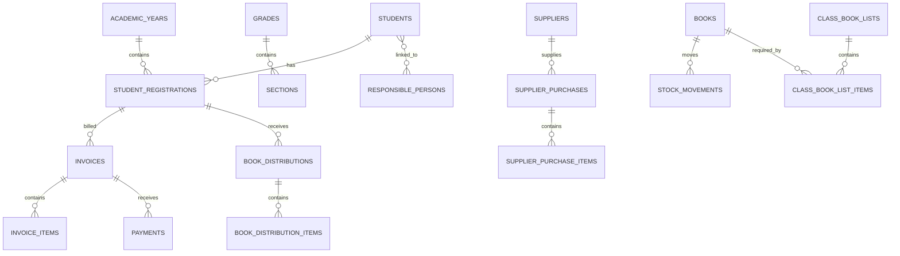

# School Book Manager architecture

## Requirements summary and assumptions

School Book Manager is a server-rendered Laravel application for a single school. It records academic history, stock movements, purchases, distributions, invoices, payments, approvals, returns, cancellations, and audit history. It is designed for MySQL 8 in production and SQLite only for local tests. Amounts are stored as `decimal(14,2)` and calculated in integer minor units by `App\\Support\\Money`.

Assumptions: one school is configured in system settings; an academic year has one active record; a registration is immutable historical evidence once active; stock is held in one warehouse; public IDs, rather than internal numeric IDs, are used in browser routes for sensitive records. Users must be assigned a role before using the system.

## Entity relationships

## Main workflows

1. Staff find or create a student, add a registration and responsible people, then select a class book list.
2. Receiving locks each book, records a supplier-purchase receipt and an immutable stock movement, then increases stock.
3. Distribution locks stock, recalculates prices server-side, creates an issued invoice and distribution, records stock movements, and optionally records an idempotent payment in one transaction.
4. A payment locks its invoice, recomputes the remaining balance, records the payment or reversal, and recalculates invoice status.
5. A return records the original distribution, restores only resellable stock, and creates a credit note/refund record where appropriate.
6. Cancellation uses an explicit status transition and reversal entries; it never deletes financial or inventory history.

## Security model

Authentication uses Laravel sessions, throttled login, password reset links, secure password hashing, session regeneration, disabled-account enforcement, and last-login auditing. Authorization is enforced through gates and policies—not view visibility. All write operations use form requests, CSRF protection, allow-listed fields, server-side totals, database transactions, row locks for stock and invoices, idempotency keys for money movement, randomized private uploads, and audit records. Production headers are applied by middleware.

## Folder structure and implementation order

* `app/Domain` contains inventory, invoicing, payment, registration, return, and cancellation workflows.
* `app/Http/Requests` validates all mutations; controllers only coordinate requests and services.
* `app/Models` holds relationships and query scopes; `app/Policies` guards records.
* `resources/views` contains reusable Blade layouts, tables, forms, and print documents.
* `database/seeders` creates roles, an administrator, and non-production demonstration data.

Implementation proceeds in this order: schema/RBAC, authentication and layout, master data, stock and purchasing, student billing/distribution, reversals/returns, reports/auditing, then automated verification and deployment documentation.
